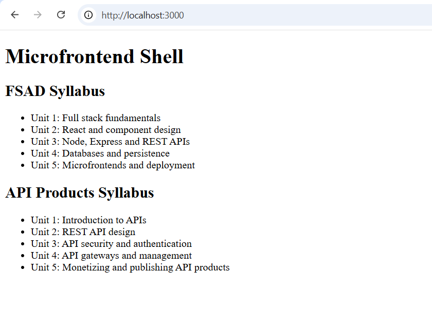

# FSAD Microfrontend Shell

## Overview

This project implements a Microfrontend architecture using **Webpack Module Federation**. It consists of a shell application that integrates two independent micro applications: FSAD and API Products.

## Features

- **Shell Application:** Acts as the host application for the microfrontends.
- **FSAD Micro App:** Displays the FSAD syllabus.
- **API Products Micro App:** Displays the API Products syllabus.
- **Module Federation:** Enables the shell to load and integrate the micro applications.

## Tech Stack

- React
- JavaScript
- Webpack
- Webpack Module Federation
- HTML and CSS

## Project Structure

```text
FSAD-microfrontend-shell/
├── fsad/
├── API-products/
├── src/
├── screenshots/
│   └── screenshot-shell.png
├── package.json
└── README.md
```

## Application Screenshot



## Installation and Execution

### 1. Clone the repository

```bash
git clone https://github.com/ishika-sancheti/FSAD-microfrontend-shell.git
cd FSAD-microfrontend-shell
```

### 2. Install dependencies

```bash
npm install
```

### 3. Build the application

```bash
npm run build
```

### 4. Run the application

Start the shell and micro applications using the scripts configured in their respective `package.json` files. Ensure the micro applications are running and their remote entry files are accessible to the shell.

## Learning Objectives

- Understand Microfrontend architecture.
- Implement Webpack Module Federation.
- Integrate independently developed micro applications into a shell.
- Configure remote modules and shared dependencies.
